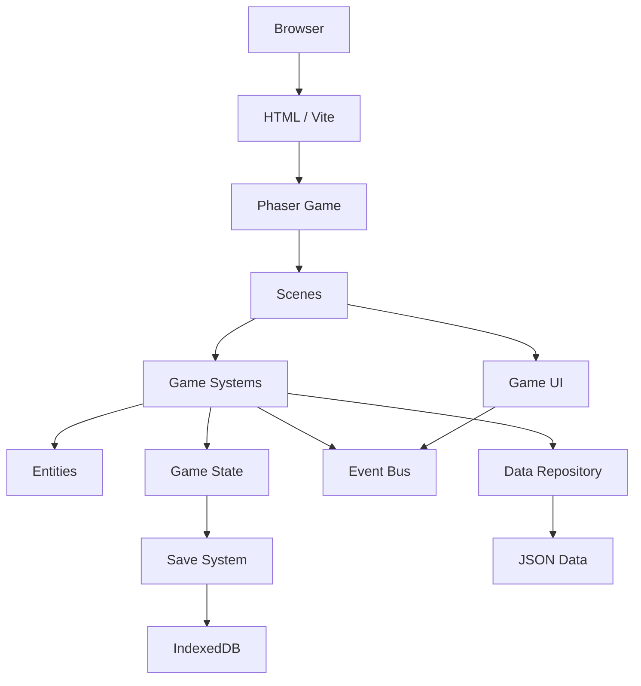
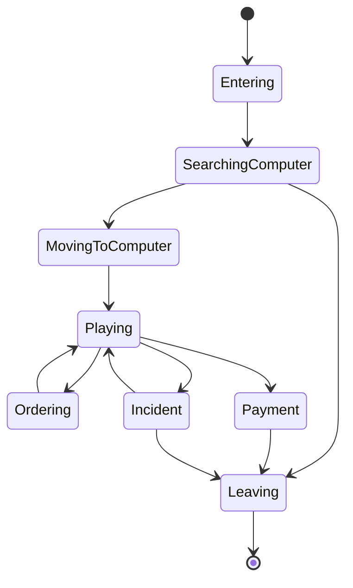

# INTERNET CAFÉ TYCOON
## GAME DESIGN DOCUMENT (GDD) & TECHNICAL DESIGN DOCUMENT (TDD)

**Version:** 1.1  
**Project Type:** HTML5 Browser Game  
**Genre:** Business Simulation / Tycoon / Survival Simulation  
**Engine:** Phaser 3  
**Build Tool:** Vite  
**Language:** JavaScript ES Modules  
**Rendering:** HTML5 Canvas  
**Art Style:** 2D Top-down Pixel Art  
**Interaction:** Point & Click  
**Time Model:** Real-time Simulation  
**Game Mode:** Single-player  
**Platform:** Desktop Browser

---

# PART I — GAME DESIGN DOCUMENT (GDD)

# 1. GAME OVERVIEW

## 1.1. Game Concept

Internet Café Tycoon là trò chơi mô phỏng quản lý tiệm internet với góc nhìn 2D Top-down Pixel Art.

Người chơi bắt đầu với một tiệm net nhỏ, số lượng máy tính hạn chế và nguồn vốn ít ỏi.

Nhiệm vụ là vận hành tiệm, thu hút khách hàng, kiếm tiền, nâng cấp thiết bị, mở rộng kinh doanh và duy trì cuộc sống gia đình.

Người chơi không chỉ quản lý một doanh nghiệp mà còn phải đối mặt với những vấn đề thực tế:

- Khách hàng quỵt tiền.
- Khách gây rối, làm hỏng thiết bị.
- Máy tính xuống cấp.
- Tiền điện, tiền Internet và tiền thuê mặt bằng.
- Nhân viên làm việc không hiệu quả.
- Gia đình cần tiền ăn uống và sưởi ấm.
- Thành viên gia đình bị bệnh.
- Các quyết định tài chính khó khăn.

Game kết hợp ba trải nghiệm chính:

1. Business Management: Quản lý và phát triển tiệm net.
2. Real-time Simulation: Quan sát và xử lý hoạt động của khách hàng.
3. Family Survival: Cân bằng tài chính kinh doanh với nhu cầu sinh tồn của gia đình.

## 1.2. Core Fantasy

Người chơi trải nghiệm hành trình:

**Từ một chủ tiệm net bình dân trở thành ông chủ một cơ sở kinh doanh lớn, đồng thời cố gắng duy trì cuộc sống gia đình ổn định.**

## 1.3. Design Pillars

### Pillar 1: Build Your Internet Café

Người chơi tự xây dựng, bố trí và nâng cấp tiệm net.

### Pillar 2: Living Customers

Khách hàng là các NPC có hành vi, nhu cầu, tính cách và lịch sử riêng.

### Pillar 3: Every Decision Matters

Mỗi quyết định có thể ảnh hưởng đến tiền bạc, danh tiếng, khách hàng và gia đình.

### Pillar 4: Business Meets Survival

Lợi nhuận kinh doanh không đồng nghĩa với cuộc sống ổn định. Người chơi phải cân bằng chi phí tiệm net và nhu cầu sinh tồn của gia đình.

---

# 2. CORE GAMEPLAY LOOP

## 2.1. Daily Gameplay Loop

1. Bắt đầu ngày mới.
2. Kiểm tra tình trạng tiệm net.
3. Mở cửa tiệm.
4. Khách hàng đến và sử dụng máy tính.
5. Khách phát sinh hóa đơn.
6. Người chơi giám sát hoạt động.
7. Xử lý sự kiện bất thường.
8. Thu tiền và quản lý doanh thu.
9. Nâng cấp máy tính hoặc cơ sở vật chất.
10. Kiểm tra nhu cầu gia đình.
11. Kết thúc ngày.
12. Thanh toán chi phí và cập nhật trạng thái sinh tồn.
13. Bắt đầu ngày tiếp theo.

## 2.2. Point & Click Interaction

Toàn bộ gameplay sử dụng chuột.

Các hành động:

- Click khách hàng để xem thông tin.
- Click máy tính để xem trạng thái.
- Click quầy thu ngân để quản lý giao dịch.
- Click cửa để mở hoặc đóng tiệm.
- Click nhân viên để xem thông tin và giao nhiệm vụ.
- Click sự kiện để xử lý.
- Click các nút trên HUD để mở bảng quản lý.
- Click đối tượng để thực hiện tương tác.

Không yêu cầu người chơi điều khiển nhân vật bằng WASD.

Người chơi đóng vai trò quản lý, quan sát và tương tác với thế giới game.

---

# 3. WORLD & VISUAL DESIGN

## 3.1. Camera

- Góc nhìn 2D Top-down.
- Camera có thể di chuyển bằng thao tác kéo chuột.
- Hỗ trợ zoom in/out.
- Có giới hạn camera trong phạm vi bản đồ.
- Hỗ trợ nhiều kích thước màn hình.

## 3.2. Pixel Art Style

Định hướng:

- Pixel art có độ chi tiết vừa phải.
- Nhân vật có animation 4 hướng.
- Nội thất có thể tương tác.
- Màu sắc gần gũi, phong cách indie.
- Ánh sáng thay đổi theo thời gian.
- Animation khách đi lại, ngồi máy, đứng dậy và thanh toán.

## 3.3. Tilemap

Sử dụng tilemap để xây dựng tiệm.

Các loại tile:

- Floor.
- Wall.
- Door.
- Window.
- Counter.
- Computer Desk.
- Chair.
- Decorative Objects.
- Lighting.

Kích thước tile đề xuất: 16x16 hoặc 32x32 pixel.

## 3.4. Environment

MVP tập trung vào một bản đồ tiệm net.

Các khu vực:

- Khu vực máy tính.
- Quầy thu ngân.
- Khu vực đồ ăn và nước uống.
- Kho chứa.
- Nhà vệ sinh.
- Khu vực VIP (mở khóa sau).

Gia đình không có bản đồ hoặc khu vực gameplay riêng. Family System hoạt động nền và hiển thị thông qua HUD và Event Dialog.

---

# 4. INTERNET CAFÉ MANAGEMENT

## 4.1. Café Overview

Người chơi quản lý toàn bộ tiệm net.

Các thông tin:

- Số lượng máy tính.
- Số lượng khách hiện tại.
- Số máy đang hoạt động.
- Số máy trống.
- Doanh thu hôm nay.
- Chi phí hôm nay.
- Tiền hiện tại.
- Danh tiếng.
- Chất lượng dịch vụ.

## 4.2. Computer Management

Mỗi máy tính có các thuộc tính:

| Attribute | Description |
|---|---|
| CPU | Hiệu năng xử lý |
| GPU | Hiệu năng đồ họa |
| RAM | Dung lượng bộ nhớ |
| Monitor | Chất lượng màn hình |
| Keyboard | Chất lượng bàn phím |
| Mouse | Chất lượng chuột |
| Condition | Tình trạng thiết bị |
| Cleanliness | Độ sạch sẽ |
| Electricity | Điện năng tiêu thụ |
| Status | Trạng thái máy |

Computer Status:

- Available.
- Occupied.
- Broken.
- Maintenance.
- Disabled.

## 4.3. Computer Tiers

- Basic PC.
- Standard PC.
- Gaming PC.
- High-end PC.
- Premium PC.

Cấu hình ảnh hưởng đến:

- Khả năng phục vụ nhóm khách.
- Giá giờ chơi.
- Mức độ hài lòng.
- Khả năng thu hút khách.
- Chi phí bảo trì.
- Điện năng tiêu thụ.

## 4.4. Computer Upgrade

Người chơi có thể:

- Mua máy mới.
- Thay CPU.
- Thay GPU.
- Nâng cấp RAM.
- Thay màn hình.
- Nâng cấp thiết bị ngoại vi.
- Sửa chữa máy tính.

Việc nâng cấp phải có tác động rõ ràng đến hiệu quả kinh doanh.

## 4.5. Pricing System

Người chơi tự thiết lập giá giờ chơi.

Ví dụ:

| Computer Tier | Example Price |
|---|---:|
| Basic PC | 5.000đ/giờ |
| Standard PC | 8.000đ/giờ |
| Gaming PC | 12.000đ/giờ |
| VIP PC | 20.000đ/giờ |

Giá cao có thể giảm lượng khách nhạy cảm với giá.

Giá thấp có thể tăng lượng khách nhưng giảm biên lợi nhuận.

## 4.6. Additional Services

Các dịch vụ bổ sung:

- Bán nước ngọt.
- Bán mì gói.
- Bán đồ ăn nhanh.
- Cho thuê tai nghe.
- In tài liệu.
- Dịch vụ nạp game.

Các dịch vụ tạo thêm doanh thu ngoài giờ chơi.

---

# 5. CUSTOMER SYSTEM

## 5.1. Customer Overview

Khách hàng là NPC có AI và hành vi riêng.

Mỗi khách có:

- ID.
- Name.
- Character Model.
- Personality.
- Money.
- Patience.
- Satisfaction.
- Preferred PC Tier.
- Visit Frequency.
- Reputation Relationship.
- Behavior Profile.

## 5.2. Customer Types

### Student

- Ngân sách thấp.
- Thường chơi lâu.
- Nhạy cảm với giá.
- Thích máy tính giá rẻ.

### Gamer

- Ưu tiên cấu hình mạnh.
- Sẵn sàng trả tiền cao hơn.
- Quan tâm chất lượng thiết bị.

### Office Worker

- Sử dụng dịch vụ trong thời gian ngắn.
- Có thể sử dụng dịch vụ in ấn.
- Ít gây rối.

### Regular Customer

- Có xu hướng quay lại.
- Có thể trở thành khách quen.
- Có mức độ trung thành.

### Troublemaker

- Có khả năng gây rối.
- Có thể quỵt tiền.
- Có thể làm hỏng thiết bị.

### Wealthy Customer

- Ngân sách cao.
- Ưu tiên dịch vụ tốt.
- Có thể chi tiêu nhiều hơn.

## 5.3. Customer AI State Machine

Các trạng thái:

1. Entering.
2. LookingForComputer.
3. MovingToComputer.
4. UsingComputer.
5. OrderingFood.
6. WaitingForPayment.
7. Paying.
8. Leaving.
9. Incident.
10. Exiting.

Luồng cơ bản:

Entering → LookingForComputer → MovingToComputer → UsingComputer → Paying → Leaving.

Nếu không có máy phù hợp, khách có thể:

- Chờ đợi.
- Chọn máy khác.
- Rời khỏi tiệm.
- Giảm mức độ hài lòng.

## 5.4. Customer Satisfaction

Sự hài lòng phụ thuộc vào:

- Giá cả.
- Cấu hình máy.
- Độ sạch sẽ.
- Tốc độ Internet.
- Nhiệt độ phòng.
- Chất lượng dịch vụ.
- Thời gian chờ.
- Mức độ an ninh.

Satisfaction ảnh hưởng đến:

- Khả năng quay lại.
- Danh tiếng.
- Đánh giá tiệm.
- Mức chi tiêu.

## 5.5. Customer Relationship

Một số khách hàng có thể trở thành khách quen.

Hệ thống lưu:

- Số lần ghé tiệm.
- Tổng tiền đã chi.
- Lịch sử sự kiện.
- Mức độ trung thành.
- Những tương tác đặc biệt.

Khách quen có thể mở khóa sự kiện riêng.

---

# 6. SECURITY & INCIDENT SYSTEM

## 6.1. Incident Types

Các sự kiện bất thường:

- Khách bỏ đi không thanh toán.
- Khách gây mất trật tự.
- Khách đánh nhau.
- Khách làm hỏng thiết bị.
- Khách tranh giành máy.
- Khách sử dụng dịch vụ quá giờ.
- Khách gian lận.
- Nhân viên xử lý sai hóa đơn.

## 6.2. Incident Resolution

Khi sự kiện xảy ra:

1. Hiển thị thông báo.
2. Đánh dấu NPC liên quan.
3. Hiển thị biểu tượng cảnh báo.
4. Người chơi click NPC để mở bảng xử lý.
5. Người chơi chọn phương án giải quyết.

Ví dụ: khách chơi xong nhưng định rời tiệm mà chưa thanh toán.

Các phương án:

- Yêu cầu thanh toán.
- Cảnh cáo.
- Gọi bảo vệ.
- Ghi nhận vi phạm.
- Chấp nhận thất thoát.

Các lựa chọn có thể tạo ra hậu quả khác nhau.

## 6.3. Security Guard

Người chơi có thể thuê bảo vệ.

Thuộc tính:

- Salary.
- Experience.
- Reaction Speed.
- Incident Handling.
- Reliability.

Các cấp độ:

- Basic Guard.
- Professional Guard.
- Senior Guard.

Bảo vệ tự động hỗ trợ xử lý một số sự kiện.

Tác dụng:

- Giảm thất thoát.
- Giảm thiệt hại thiết bị.
- Giảm thời gian xử lý sự cố.
- Tăng cảm giác an toàn cho khách.

Bảo vệ không loại bỏ hoàn toàn sự kiện.

---

# 7. ECONOMY SYSTEM

## 7.1. Revenue

Nguồn thu:

- Giờ chơi máy tính.
- Đồ ăn.
- Nước uống.
- Dịch vụ bổ sung.
- Phòng VIP.

## 7.2. Expenses

Chi phí kinh doanh:

- Tiền điện.
- Tiền Internet.
- Tiền thuê mặt bằng.
- Lương nhân viên.
- Lương bảo vệ.
- Chi phí sửa chữa.
- Chi phí hàng hóa.
- Thuế và các khoản phí.

Chi phí gia đình được quản lý bởi Family System nhưng sử dụng chung Economy System.

## 7.3. Financial Management

Người chơi theo dõi:

- Cash Balance.
- Daily Revenue.
- Daily Expenses.
- Net Profit.
- Outstanding Debt.
- Family Expenses.

## 7.4. Debt System

Người chơi có thể vay vốn để:

- Mua máy tính.
- Mở rộng tiệm.
- Nâng cấp cơ sở vật chất.

Khoản vay có:

- Principal.
- Interest Rate.
- Repayment Schedule.
- Remaining Debt.

Không để vay vốn trở thành cách kiếm tiền vô hạn.

---

# 8. FAMILY SURVIVAL SYSTEM

## 8.1. Design Philosophy

Family System là hệ thống mô phỏng sinh tồn chạy nền.

Không xây dựng một khu vực gameplay gia đình riêng.

Không có:

- HomeScene.
- FamilyScene.
- Bản đồ nhà.
- Điều khiển nhân vật gia đình.
- Animation tương tác gia đình phức tạp.
- Giao diện quản lý gia đình toàn màn hình.

Thay vào đó, người chơi theo dõi tình trạng gia đình qua Family Status Panel và xử lý sự kiện thông qua Event Dialog.

Gia đình tạo áp lực tài chính và cảm xúc lên hoạt động kinh doanh.

## 8.2. Family Members

Gia đình ban đầu:

- Player.
- Wife.
- Child.

Mỗi thành viên có:

- ID.
- Name.
- Health.
- Hunger.
- Cold.
- Sickness Level.
- Status.
- History.

Không cần mô phỏng hành vi di chuyển hoặc hoạt động riêng của từng thành viên.

## 8.3. Daily Survival Needs

Người chơi phải đảm bảo ba nhu cầu:

### Food

Thức ăn được tiêu thụ hàng ngày.

Nếu không đủ thức ăn:

- Thành viên bắt đầu bị Hungry.
- Tình trạng đói kéo dài ảnh hưởng đến sức khỏe.
- Có thể dẫn đến Sick.

### Heat

Tiền sưởi hoặc nguồn sưởi cần được đảm bảo hàng ngày.

Nếu không đủ sưởi:

- Thành viên bắt đầu bị Cold.
- Tình trạng lạnh kéo dài ảnh hưởng đến sức khỏe.
- Có thể dẫn đến Sick.

### Medicine

Thuốc không phải khoản chi bắt buộc mỗi ngày.

Medicine là nguồn lực cần thiết khi thành viên bị bệnh.

Nếu không được điều trị kịp thời:

- Sick có thể tiến triển thành Very Sick.
- Very Sick có nguy cơ dẫn đến Deceased.

## 8.4. Family Status

| Status | Description |
|---|---|
| Healthy | Sức khỏe bình thường |
| Hungry | Thiếu thức ăn |
| Cold | Thiếu sưởi |
| Sick | Bị bệnh |
| Very Sick | Bệnh nặng |
| Deceased | Đã qua đời |

Một thành viên có thể đồng thời chịu ảnh hưởng của nhiều nhu cầu.

Status chính hiển thị theo mức độ nghiêm trọng cao nhất, trong khi Hunger và Cold được theo dõi riêng.

## 8.5. Health Progression

Luồng trạng thái khái quát:

Healthy → Hungry / Cold → Sick → Very Sick → Deceased.

Điều trị, cung cấp thức ăn và sưởi ấm có thể ngăn chặn hoặc đảo ngược tiến trình tùy mức độ.

Các thông số phải được cân bằng qua playtesting.

## 8.6. Daily Family Expenses

Chi phí gia đình:

- Food.
- Heat.

Medicine được mua khi cần thiết.

Người chơi phải cân đối:

- Tiền mua máy tính.
- Tiền nâng cấp.
- Tiền thuê bảo vệ.
- Tiền thức ăn.
- Tiền sưởi.
- Tiền thuốc.

Đây là xung đột kinh tế cốt lõi giữa kinh doanh và sinh tồn.

## 8.7. Family Event Dialog

Khi phát sinh sự kiện quan trọng, game hiển thị một dialog.

Ví dụ:

**Event: Your Child Is Sick**

Nội dung:

Con bạn bị ốm. Gia đình cần mua thuốc để điều trị. Nếu tiếp tục trì hoãn, tình trạng sức khỏe có thể trở nên nghiêm trọng hơn.

Các lựa chọn:

A. Buy Medicine.

- Kiểm tra số lượng thuốc.
- Trừ tiền hoặc tiêu thụ thuốc.
- Cập nhật sức khỏe.
- Đóng dialog.

B. Delay Treatment.

- Không mất tiền ngay.
- Ghi nhận quyết định.
- Có thể phát sinh hậu quả sau đó.

Các sự kiện khác:

- Gia đình thiếu thức ăn.
- Gia đình không đủ tiền sưởi.
- Vợ bị bệnh.
- Con bị bệnh.
- Gia đình cần tiền khẩn cấp.
- Chi phí sinh hoạt tăng.

Sự kiện quan trọng có thể tự động Pause simulation để người chơi xử lý.

## 8.8. Family Status Panel

Một bảng thông tin nhỏ trên HUD.

Hiển thị:

- Portrait.
- Name.
- Health Status.
- Hunger Status.
- Cold Status.
- Food Resource.
- Medicine Resource.
- Heat Payment Status.

Không cần tạo một màn hình riêng.

## 8.9. Family Consequences

Các lựa chọn và sự kiện được lưu lại.

Ví dụ:

- Thường xuyên thiếu thức ăn có thể khiến sức khỏe gia đình suy giảm.
- Không mua thuốc có thể khiến bệnh tiến triển.
- Ưu tiên nâng cấp máy tính thay vì nhu cầu gia đình có thể tạo hậu quả dài hạn.

Hệ thống phải có cảnh báo đủ sớm để người chơi có cơ hội xử lý.

## 8.10. Family System Scope

Family System chỉ quản lý:

- Survival Needs.
- Daily Expenses.
- Health.
- Illness.
- Medicine.
- Events.
- Family Status.

Không triển khai Relationship Simulation phức tạp, hệ thống trò chuyện, hoạt động trong nhà hoặc lịch sinh hoạt cá nhân trong MVP.

---

# 9. EVENT & DECISION SYSTEM

## 9.1. Event Categories

- Business Events.
- Customer Events.
- Security Events.
- Employee Events.
- Family Events.
- Financial Events.
- Random Events.
- Story Events.

## 9.2. Event Structure

Mỗi event có:

- Event ID.
- Category.
- Title.
- Description.
- Character Involved.
- Conditions.
- Choices.
- Consequences.
- Priority.
- Cooldown.
- Trigger Rules.

## 9.3. Decision Design

Mỗi lựa chọn phải có trade-off.

Ví dụ:

Một khách quen thường xuyên chơi thiếu tiền.

- Cho khách nợ.
- Yêu cầu thanh toán.
- Cấm khách quay lại.

Mỗi phương án ảnh hưởng đến các hệ thống khác nhau.

## 9.4. Narrative Flags

Hệ thống lưu những lựa chọn quan trọng.

Ví dụ:

- regular_customer_banned.
- security_guard_hired.
- child_treatment_delayed.
- family_food_shortage.
- business_expanded.

Các flag được sử dụng để kiểm tra điều kiện kích hoạt sự kiện tương lai.

---

# 10. PROGRESSION SYSTEM

## 10.1. Business Progression

### Stage 1: Small Internet Café

- 3–5 máy.
- Không có nhân viên.
- Chủ tự quản lý.
- Vốn hạn chế.

### Stage 2: Growing Café

- 10–15 máy.
- Thuê bảo vệ.
- Có nhân viên.
- Bán thêm đồ ăn và nước uống.

### Stage 3: Gaming Café

- 20–30 máy.
- Có máy cấu hình cao.
- Có khu vực VIP.
- Lượng khách tăng.

### Stage 4: Premium Internet Café

- 40–50 máy.
- Hệ thống nhân viên hoàn chỉnh.
- Dịch vụ đa dạng.
- Cơ sở vật chất cao cấp.

### Stage 5: Café Business Owner

- Mở thêm chi nhánh.
- Quản lý nhiều cơ sở.
- Tự động hóa hoạt động.
- Phát triển thương hiệu.

## 10.2. Unlock System

Các tính năng được mở khóa dựa trên:

- Số ngày hoạt động.
- Danh tiếng.
- Doanh thu tích lũy.
- Số lượng khách.
- Mốc nâng cấp.
- Sự kiện cốt truyện.

---

# 11. TIME & DAY CYCLE

## 11.1. Real-time Simulation

Game sử dụng thời gian mô phỏng riêng.

Một ngày có các giai đoạn:

- Morning.
- Afternoon.
- Evening.
- Night.

Khách xuất hiện theo khung giờ.

| Time | Customer Pattern |
|---|---|
| 07:00–10:00 | Học sinh, sinh viên |
| 10:00–14:00 | Khách vãng lai |
| 14:00–18:00 | Sinh viên, game thủ |
| 18:00–23:00 | Game thủ, khách quen |
| 23:00–02:00 | Khách chơi đêm |

## 11.2. Time Controls

- Pause.
- Resume.
- Speed x1.
- Speed x2.
- Speed x3.

Các sự kiện quan trọng có thể tự động tạm dừng simulation.

## 11.3. Day Ending

Khi kết thúc ngày:

- Tính doanh thu.
- Tính chi phí.
- Thanh toán lương.
- Tính chi phí gia đình.
- Cập nhật trạng thái sinh tồn.
- Kiểm tra tình trạng bệnh.
- Xử lý sự kiện theo ngày.
- Tạo báo cáo tài chính.
- Chuẩn bị ngày tiếp theo.

---

# 12. UI/UX DESIGN

## 12.1. Main HUD

Thông tin hiển thị:

- Current Date.
- Current Time.
- Money.
- Customer Count.
- Available Computers.
- Reputation.
- Active Incidents.

## 12.2. Management Panels

Các bảng quản lý:

- Café Overview.
- Computer Management.
- Customer Information.
- Employee Management.
- Security Management.
- Inventory.
- Shop.
- Financial Report.
- Family Status.
- Event Journal.

## 12.3. Interaction UX

Khi click vào đối tượng:

- Hiển thị outline.
- Hiển thị tooltip.
- Mở bảng thông tin.
- Cho phép thực hiện hành động.

## 12.4. Visual Feedback

- Máy đang sử dụng có đèn báo.
- Máy hỏng có biểu tượng cảnh báo.
- Khách cần thanh toán có biểu tượng.
- Khách gây rối có cảnh báo.
- Nhân viên đang làm nhiệm vụ có trạng thái riêng.
- Gia đình gặp vấn đề có biểu tượng trên HUD.

## 12.5. Dialog System

Sử dụng một Dialog System dùng chung cho:

- Customer Incidents.
- Family Events.
- Business Events.
- Employee Events.
- Story Events.

Không tạo một dialog engine riêng cho từng loại sự kiện.

---

# 13. SAVE & GAME END

## 13.1. Save System

- Manual Save.
- Auto Save.
- Multiple Save Slots.
- Save at Day End.

## 13.2. Game End Conditions

Các hướng kết thúc:

- Business Success.
- Financial Collapse.
- Family Survival Failure.
- Balanced Life Ending.
- Business Empire Ending.

Có thể tiếp tục chơi dạng Sandbox sau khi đạt các mốc thành công nếu thiết kế cho phép.

---

# PART II — TECHNICAL DESIGN DOCUMENT (TDD)

# 14. TECHNOLOGY STACK

| Layer | Technology |
|---|---|
| Game Engine | Phaser 3 |
| Programming Language | JavaScript ES Modules |
| Build Tool | Vite |
| Rendering | HTML5 Canvas |
| Map | Tiled JSON / Phaser Tilemap |
| Pathfinding | A* Grid-based |
| UI | Phaser Game Objects + HTML/CSS overlay |
| Data | JSON |
| Persistence | IndexedDB |
| Asset | PNG / WebP / JSON / Audio |
| Testing | Vitest |
| Version Control | Git |

## 14.1. Architecture Principles

1. Modular Architecture.
2. Separation of Concerns.
3. Data-driven Gameplay.
4. Event-driven Communication.
5. Reusable Game Systems.
6. Centralized Game State.
7. Avoid unnecessary abstractions.
8. No backend dependency for MVP.

Game chạy hoàn toàn trên trình duyệt trong phiên bản đầu tiên.

---

# 15. PROJECT FOLDER STRUCTURE

```text
internet-cafe-tycoon/
│
├── public/
│   └── assets/
│       ├── maps/
│       ├── tilesets/
│       ├── characters/
│       │   ├── customers/
│       │   └── staff/
│       ├── furniture/
│       ├── computers/
│       ├── items/
│       ├── icons/
│       ├── effects/
│       ├── audio/
│       │   ├── music/
│       │   └── sfx/
│       └── fonts/
│
├── src/
│   ├── main.js
│   │
│   ├── core/
│   │   ├── Game.js
│   │   ├── GameConfig.js
│   │   ├── GameRegistry.js
│   │   └── EventBus.js
│   │
│   ├── scenes/
│   │   ├── BootScene.js
│   │   ├── PreloadScene.js
│   │   ├── MainMenuScene.js
│   │   ├── CafeScene.js
│   │   └── ResultScene.js
│   │
│   ├── entities/
│   │   ├── customers/
│   │   │   ├── Customer.js
│   │   │   ├── CustomerFactory.js
│   │   │   └── CustomerState.js
│   │   ├── staff/
│   │   │   ├── Employee.js
│   │   │   └── SecurityGuard.js
│   │   ├── computers/
│   │   │   └── Computer.js
│   │   └── objects/
│   │       ├── Furniture.js
│   │       └── InteractiveObject.js
│   │
│   ├── systems/
│   │   ├── simulation/
│   │   │   ├── TimeSystem.js
│   │   │   ├── DayCycleSystem.js
│   │   │   └── SimulationSystem.js
│   │   │
│   │   ├── customer/
│   │   │   ├── CustomerAISystem.js
│   │   │   ├── CustomerSpawnSystem.js
│   │   │   ├── CustomerBehaviorSystem.js
│   │   │   └── CustomerRelationshipSystem.js
│   │   │
│   │   ├── movement/
│   │   │   ├── PathfindingSystem.js
│   │   │   └── MovementSystem.js
│   │   │
│   │   ├── business/
│   │   │   ├── RevenueSystem.js
│   │   │   ├── ExpenseSystem.js
│   │   │   ├── PricingSystem.js
│   │   │   └── UpgradeSystem.js
│   │   │
│   │   ├── security/
│   │   │   ├── IncidentSystem.js
│   │   │   └── SecuritySystem.js
│   │   │
│   │   ├── family/
│   │   │   ├── FamilySurvivalSystem.js
│   │   │   ├── FamilyExpenseSystem.js
│   │   │   ├── FamilyHealthSystem.js
│   │   │   └── FamilyEventSystem.js
│   │   │
│   │   ├── event/
│   │   │   ├── EventSystem.js
│   │   │   ├── DecisionSystem.js
│   │   │   └── NarrativeFlagSystem.js
│   │   │
│   │   ├── inventory/
│   │   │   └── InventorySystem.js
│   │   │
│   │   └── save/
│   │       ├── SaveSystem.js
│   │       └── SaveSerializer.js
│   │
│   ├── managers/
│   │   ├── AssetManager.js
│   │   ├── InputManager.js
│   │   ├── CameraManager.js
│   │   ├── AudioManager.js
│   │   └── SceneManager.js
│   │
│   ├── ui/
│   │   ├── hud/
│   │   │   ├── MainHUD.js
│   │   │   └── FamilyStatusPanel.js
│   │   │
│   │   ├── panels/
│   │   │   ├── CafeOverviewPanel.js
│   │   │   ├── ComputerPanel.js
│   │   │   ├── CustomerPanel.js
│   │   │   ├── EmployeePanel.js
│   │   │   ├── InventoryPanel.js
│   │   │   └── FinancePanel.js
│   │   │
│   │   ├── dialogs/
│   │   │   ├── DialogManager.js
│   │   │   ├── EventDialog.js
│   │   │   └── ConfirmationDialog.js
│   │   │
│   │   ├── notifications/
│   │   │   └── NotificationManager.js
│   │   │
│   │   └── components/
│   │       ├── Button.js
│   │       ├── Tooltip.js
│   │       └── ProgressBar.js
│   │
│   ├── data/
│   │   ├── customers/
│   │   ├── computers/
│   │   ├── upgrades/
│   │   ├── employees/
│   │   ├── events/
│   │   ├── family/
│   │   │   ├── family-members.json
│   │   │   ├── survival-config.json
│   │   │   └── family-events.json
│   │   ├── economy/
│   │   └── maps/
│   │
│   ├── state/
│   │   ├── GameState.js
│   │   ├── CafeState.js
│   │   ├── EconomyState.js
│   │   ├── FamilyState.js
│   │   └── SettingsState.js
│   │
│   ├── utils/
│   │   ├── Constants.js
│   │   ├── MathUtils.js
│   │   ├── RandomUtils.js
│   │   └── ValidationUtils.js
│   │
│   └── styles/
│       ├── main.css
│       └── interface.css
│
├── tests/
│   ├── systems/
│   ├── economy/
│   ├── family/
│   └── utils/
│
├── index.html
├── package.json
├── vite.config.js
├── README.md
└── .gitignore
```

Đây là cấu trúc mục tiêu. Chỉ tạo module khi cần triển khai chức năng tương ứng.

---

# 16. APPLICATION ARCHITECTURE

## 16.1. High-level Architecture



## 16.2. Core Layer

Core chịu trách nhiệm:

- Khởi tạo Phaser.
- Cấu hình renderer.
- Cấu hình game dimensions.
- Đăng ký scenes.
- Khởi tạo shared services.

Không chứa logic kinh doanh hoặc logic gia đình.

## 16.3. Scene Layer

### BootScene

- Khởi tạo cấu hình cơ bản.
- Đăng ký GameRegistry.
- Khởi tạo EventBus.

### PreloadScene

- Load assets.
- Load tilemaps.
- Load animation definitions.
- Load gameplay data.

### MainMenuScene

- New Game.
- Continue.
- Load Game.
- Settings.

### CafeScene

- Render bản đồ.
- Render NPC.
- Render computer.
- Render furniture.
- Điều phối các hệ thống tiệm.
- Xử lý point and click.

### ResultScene

- Báo cáo tài chính.
- Tổng kết ngày.
- Tổng kết sự kiện quan trọng.

Không có HomeScene hoặc FamilyScene.

Family System chạy nền trong simulation và được hiển thị thông qua UI.

---

# 17. GAME STATE ARCHITECTURE

GameState là nguồn dữ liệu chính của gameplay.

Ví dụ:

```javascript
const gameState = {
  meta: {
    version: 1,
    currentDay: 1,
    currentTime: 480,
    isPaused: false
  },

  player: {
    name: "Player",
    money: 5000000
  },

  cafe: {
    name: "My Internet Cafe",
    reputation: 50,
    computers: [],
    customers: [],
    employees: [],
    inventory: []
  },

  economy: {
    dailyRevenue: 0,
    dailyExpenses: 0,
    debt: 0,
    transactions: []
  },

  family: {
    members: [],
    resources: {
      food: 5,
      medicine: 2,
      heatBudget: 0
    },
    dailyExpenses: {
      food: 50000,
      heat: 30000
    },
    pendingEvents: [],
    history: []
  },

  narrative: {
    flags: {},
    completedEvents: [],
    eventHistory: []
  }
};
```

Đây là schema khởi tạo minh họa.

Nguyên tắc:

- State là dữ liệu gameplay.
- Scene là nơi trình bày thế giới game.
- Systems là nơi thực hiện quy tắc gameplay.
- UI là nơi hiển thị và gửi yêu cầu hành động.
- SaveSystem chịu trách nhiệm serialize và persist state.

Không để mỗi Scene tự quản lý một bản dữ liệu tài chính hoặc gia đình độc lập.

---

# 18. EVENT-DRIVEN ARCHITECTURE

Sử dụng EventBus để các module giao tiếp độc lập.

Các event chính:

```javascript
export const GameEvents = {
  CUSTOMER_ARRIVED: "customer:arrived",
  CUSTOMER_SEATED: "customer:seated",
  CUSTOMER_LEFT: "customer:left",

  PAYMENT_RECEIVED: "payment:received",
  PAYMENT_FAILED: "payment:failed",

  COMPUTER_BROKEN: "computer:broken",
  COMPUTER_UPGRADED: "computer:upgraded",

  INCIDENT_CREATED: "incident:created",
  INCIDENT_RESOLVED: "incident:resolved",

  FAMILY_STATUS_CHANGED: "family:status:changed",
  FAMILY_RESOURCE_LOW: "family:resource:low",
  FAMILY_EVENT_TRIGGERED: "family:event:triggered",
  FAMILY_MEMBER_SICK: "family:member:sick",
  FAMILY_MEMBER_DECEASED: "family:member:deceased",

  DAY_STARTED: "day:started",
  DAY_ENDED: "day:ended",

  MONEY_CHANGED: "economy:money:changed",
  SAVE_COMPLETED: "save:completed"
};
```

Ví dụ khi khách thanh toán:

1. Customer phát sinh yêu cầu thanh toán.
2. RevenueSystem kiểm tra hóa đơn.
3. EconomyState được cập nhật.
4. EventBus phát PAYMENT_RECEIVED.
5. UI cập nhật tiền.
6. Customer chuyển sang Leaving.

Không để UI tự cộng tiền.

---

# 19. CUSTOMER AI ARCHITECTURE

## 19.1. Customer State Machine



## 19.2. Customer Behavior

CustomerAISystem chịu trách nhiệm:

- Kiểm tra nhu cầu.
- Tìm máy phù hợp.
- Xác định hành vi.
- Đánh giá điều kiện chuyển state.
- Trigger hành động tiếp theo.

Customer không được tự ý sửa EconomyState.

## 19.3. Pathfinding

Sử dụng A* trên lưới tilemap.

Tile được phân loại:

- Walkable.
- Blocked.
- Occupied.
- Interaction Point.
- Entrance.
- Exit.

NPC cần có khả năng:

- Tìm đường đến máy.
- Tránh vật cản.
- Tránh đi xuyên NPC khác.
- Di chuyển đến cửa ra.
- Tìm đường thay thế khi lối đi bị chiếm.

Không cần mô phỏng vật lý phức tạp.

---

# 20. TIME SIMULATION ARCHITECTURE

TimeSystem quản lý thời gian mô phỏng.

Không sử dụng Date.now() trực tiếp cho logic gameplay.

Quy ước:

- Một game minute tương ứng với một khoảng thời gian thực cấu hình được.
- Tốc độ mô phỏng có thể thay đổi.
- Pause dừng simulation.
- UI animation không nhất thiết phải dừng khi simulation pause.

Ví dụ:

```javascript
class TimeSystem {
  constructor(config) {
    this.config = config;
    this.gameMinutes = 480;
    this.speed = 1;
    this.paused = false;
  }

  update(delta) {
    if (this.paused) return;

    const minutes =
      (delta / 1000) *
      this.config.gameMinutesPerSecond *
      this.speed;

    this.gameMinutes += minutes;
  }

  setSpeed(speed) {
    this.speed = speed;
  }

  pause() {
    this.paused = true;
  }

  resume() {
    this.paused = false;
  }
}
```

Cần bổ sung:

- Day rollover.
- Daily expense trigger.
- Customer spawn schedule.
- Family survival update.
- Event schedule.
- Save state.

Các hệ thống dùng chung simulation clock.

---

# 21. ECONOMY ARCHITECTURE

EconomySystem chịu trách nhiệm:

- Ghi nhận doanh thu.
- Ghi nhận chi phí.
- Thanh toán hóa đơn.
- Tính lợi nhuận.
- Quản lý khoản nợ.
- Thanh toán lương.
- Thanh toán chi phí gia đình.

Mọi giao dịch được ghi nhận thành transaction.

Ví dụ:

```javascript
{
  id: "transaction_001",
  type: "revenue",
  category: "computer_usage",
  amount: 35000,
  description: "Customer payment",
  day: 1,
  timestamp: 850
}
```

Quy tắc:

- Không cộng/trừ tiền trực tiếp từ UI.
- Không cho phép giao dịch âm ngoài các trường hợp được thiết kế.
- Giao dịch quan trọng phải có ID duy nhất.
- Báo cáo ngày được tính từ transaction ledger.
- Tránh ghi nhận thanh toán hai lần.

---

# 22. FAMILY SURVIVAL ARCHITECTURE

## 22.1. FamilySurvivalSystem

Chịu trách nhiệm:

- Kiểm tra Food mỗi ngày.
- Kiểm tra Heat mỗi ngày.
- Cập nhật Hunger.
- Cập nhật Cold.
- Kiểm tra tình trạng sức khỏe.
- Kiểm tra ngưỡng bệnh.
- Trigger Family Events.

## 22.2. FamilyExpenseSystem

Chịu trách nhiệm:

- Tính chi phí thức ăn.
- Tính chi phí sưởi.
- Trừ tiền theo chu kỳ.
- Kiểm tra khả năng thanh toán.
- Phát sinh sự kiện thiếu nguồn lực.

## 22.3. FamilyHealthSystem

Chịu trách nhiệm:

- Theo dõi bệnh.
- Kiểm tra mức độ nghiêm trọng.
- Xử lý điều trị.
- Tính tiến trình hồi phục.
- Kiểm tra tình trạng nguy cấp.
- Xử lý hậu quả khi không điều trị.

## 22.4. FamilyEventSystem

Chịu trách nhiệm:

- Kiểm tra điều kiện sự kiện.
- Đưa sự kiện vào hàng đợi.
- Gửi sự kiện đến DialogManager.
- Nhận lựa chọn.
- Áp dụng effects.
- Lưu lịch sử sự kiện.

## 22.5. FamilyState

Ví dụ:

```javascript
const familyState = {
  members: [
    {
      id: "wife",
      name: "Wife",
      status: "healthy",
      hunger: 0,
      cold: 0,
      health: 100,
      sicknessLevel: 0
    },
    {
      id: "child",
      name: "Child",
      status: "healthy",
      hunger: 0,
      cold: 0,
      health: 100,
      sicknessLevel: 0
    }
  ],

  resources: {
    food: 5,
    medicine: 2,
    heatBudget: 0
  },

  dailyExpenses: {
    food: 50000,
    heat: 30000
  },

  pendingEvents: [],
  history: []
};
```

Các giá trị phải được điều chỉnh qua playtesting.

## 22.6. Survival Configuration

Ví dụ `survival-config.json`:

```json
{
  "dailyNeeds": {
    "food": {
      "consumptionPerMember": 1,
      "costPerUnit": 25000
    },
    "heat": {
      "dailyCost": 30000
    }
  },
  "health": {
    "hungerThreshold": 2,
    "coldThreshold": 2,
    "sickThreshold": 3,
    "verySickThreshold": 5
  },
  "medicine": {
    "costPerUnit": 150000,
    "recoveryRate": 25
  }
}
```

Các thông số này là giá trị khởi đầu, không phải cân bằng cuối cùng.

## 22.7. Family Event Configuration

Ví dụ `family-events.json`:

```json
{
  "id": "child_sick_001",
  "category": "family",
  "trigger": "health_status_changed",
  "conditions": {
    "memberId": "child",
    "status": "sick"
  },
  "dialog": {
    "title": "Your child is sick",
    "description": "Your child needs medicine.",
    "priority": "urgent"
  },
  "choices": [
    {
      "id": "buy_medicine",
      "label": "Buy Medicine",
      "effects": [
        {
          "type": "consume_resource",
          "resource": "medicine",
          "amount": 1
        },
        {
          "type": "recover_health",
          "target": "child",
          "amount": 25
        }
      ]
    },
    {
      "id": "delay",
      "label": "Delay Treatment",
      "effects": [
        {
          "type": "set_flag",
          "key": "child_treatment_delayed",
          "value": true
        }
      ]
    }
  ]
}
```

Effect Executor phải kiểm tra tài nguyên và điều kiện trước khi thực thi.

Không cho JSON tự ý thực thi JavaScript.

## 22.8. Family UI Integration

Family System không có Scene riêng.

Luồng:

1. FamilySurvivalSystem phát hiện trạng thái thay đổi.
2. FamilyEventSystem xác định có cần tạo event.
3. EventSystem đưa event vào queue.
4. DialogManager nhận event.
5. EventDialog hiển thị nội dung.
6. Người chơi chọn phương án.
7. DecisionSystem thực thi effects.
8. FamilyState được cập nhật.
9. FamilyStatusPanel refresh.

---

# 23. EVENT & DECISION ARCHITECTURE

Mỗi event là cấu trúc dữ liệu.

Event gồm:

- ID.
- Category.
- Conditions.
- Dialog.
- Choices.
- Effects.
- Priority.
- Cooldown.

EventSystem có nhiệm vụ:

1. Kiểm tra điều kiện.
2. Chọn sự kiện phù hợp.
3. Đưa sự kiện vào hàng đợi.
4. Hiển thị giao diện.
5. Nhận lựa chọn.
6. Thực thi effects.
7. Lưu lịch sử.
8. Cập nhật narrative flags.

Sử dụng một EventDialog dùng chung cho mọi loại sự kiện.

Effect Executor phải dùng whitelist các effect type được hỗ trợ.

Ví dụ:

- add_money.
- subtract_money.
- consume_resource.
- recover_health.
- set_status.
- add_reputation.
- set_flag.
- add_debt.
- resolve_incident.

---

# 24. SAVE SYSTEM ARCHITECTURE

Sử dụng IndexedDB làm nơi lưu dữ liệu chính.

Các object stores:

- saves.
- settings.
- metadata.

Save data gồm:

- Game metadata.
- Current day and time.
- Player.
- Café.
- Customers.
- Computers.
- Employees.
- Economy.
- Family.
- Narrative.
- Inventory.

Yêu cầu:

- Auto Save định kỳ.
- Save khi kết thúc ngày.
- Manual Save.
- Multiple Save Slots.
- Version Migration.
- Validate dữ liệu trước khi load.

Không lưu trực tiếp Phaser Game Objects vào IndexedDB.

Chỉ lưu dữ liệu thuần JSON có thể serialize.

---

# 25. ASSET & ANIMATION PIPELINE

Sử dụng Tiled để thiết kế tilemap.

Asset được tổ chức theo chức năng.

Character cần:

- Idle animation.
- Walking animation.
- Sitting animation.
- Interaction animation.
- Directional sprites.

Computer cần:

- Idle state.
- In-use state.
- Broken state.

Các animation phải được đăng ký tập trung.

Không tạo animation trùng lặp ở từng Scene.

---

# 26. RENDERING & PERFORMANCE

## 26.1. Rendering

- Phaser WebGL renderer.
- Canvas fallback khi cần.
- Pixel art sử dụng pixelArt configuration.
- Hạn chế scale sprite tùy tiện.
- Camera smoothing phù hợp với pixel art.

## 26.2. Performance

- Chỉ cập nhật AI cần thiết.
- Dùng spatial lookup để tìm NPC gần đối tượng.
- Hạn chế tạo và hủy Game Objects liên tục.
- Reuse UI components.
- Giới hạn số lượng NPC hoạt động đồng thời.
- Sử dụng spritesheet khi phù hợp.

## 26.3. Responsive

- Game canvas giữ tỷ lệ phù hợp.
- UI điều chỉnh theo màn hình.
- Ưu tiên desktop.
- Mobile là mục tiêu tương thích bổ sung.

---

# 27. TESTING STRATEGY

## Economy

- Thanh toán chính xác.
- Không thanh toán hai lần.
- Không cộng sai doanh thu.
- Chi phí ngày chính xác.
- Không tiêu tiền vượt số dư ngoài quy tắc được thiết kế.

## Customer

- Không ngồi vào máy đang sử dụng.
- Không đi xuyên vật cản.
- Chuyển state chính xác.
- Có thể rời khỏi tiệm.

## Family

- Food consumption chính xác.
- Heat expense chính xác.
- Hunger và Cold tăng đúng điều kiện.
- Medicine chỉ được sử dụng khi có đủ tài nguyên.
- Bệnh tiến triển đúng ngưỡng.
- Điều trị cập nhật sức khỏe chính xác.
- Không phát sinh sự kiện trùng lặp.
- Không xử lý một thành viên đã Deceased như người còn sống.

## Events

- Trigger đúng điều kiện.
- Choices chỉ được thực thi một lần.
- Effect Executor validate dữ liệu.
- Event queue xử lý đúng priority.

## Save

- Save/load đúng dữ liệu.
- Không mất transaction.
- Version migration hoạt động.
- FamilyState được lưu chính xác.

## Simulation

- Pause thực sự dừng simulation.
- Speed x2/x3 chính xác.
- Không bỏ sót sự kiện khi tăng tốc.
- Daily expenses chỉ được ghi nhận một lần mỗi ngày.

---

# PART III — DEVELOPMENT ROADMAP

# 28. DEVELOPMENT PHASES

## Phase 1: Foundation

Mục tiêu: Có game chạy được với bản đồ và giao diện cơ bản.

Deliverables:

- Khởi tạo Phaser 3 + Vite.
- BootScene.
- PreloadScene.
- MainMenuScene.
- CafeScene.
- Tilemap.
- Camera.
- Point & Click.
- Basic HUD.
- DialogManager.

## Phase 2: Café Simulation

Deliverables:

- Computer entities.
- Customer entities.
- Customer State Machine.
- Customer spawning.
- Pathfinding.
- Computer occupancy.
- Playing timer.
- Payment system.

## Phase 3: Business Management

Deliverables:

- Economy System.
- Pricing System.
- Daily Report.
- Computer Upgrade.
- Furniture Placement.
- Inventory.
- Food and Drinks.

## Phase 4: Incident & Security

Deliverables:

- Incident System.
- Customer fraud events.
- Incident interaction.
- Security Guard.
- Staff Management.
- Incident Resolution.

## Phase 5: Family Survival & Events

Deliverables:

- FamilyState.
- FamilySurvivalSystem.
- Daily Expenses.
- Food Management.
- Heat Management.
- Medicine Management.
- Health & Illness.
- FamilyStatusPanel.
- FamilyEventDialog.
- Event Queue.
- Decision System.

Không xây dựng HomeScene hoặc FamilyScene.

## Phase 6: Progression & Polish

Deliverables:

- Café Expansion.
- VIP Area.
- More Customer Types.
- More Events.
- Audio.
- Animations.
- Save Slots.
- Economy Balancing.
- Performance Optimization.

---

# 29. MVP ACCEPTANCE CRITERIA

MVP được xem là hoàn thành khi:

1. Người chơi có thể bắt đầu game mới.
2. Có bản đồ tiệm net Top-down.
3. Có ít nhất 5 máy tính.
4. NPC tự đi vào tiệm.
5. NPC tự tìm và sử dụng máy.
6. Hệ thống tính tiền theo thời gian.
7. Người chơi click máy để xem trạng thái.
8. Người chơi có thể nâng cấp máy.
9. Có sự kiện khách quỵt tiền.
10. Người chơi có thể xử lý sự kiện.
11. Có hệ thống bảo vệ cơ bản.
12. Có chu kỳ ngày và đêm.
13. Có báo cáo doanh thu và chi phí.
14. Có gia đình gồm vợ và con trong FamilyState.
15. Có Food, Heat và Medicine.
16. Có trạng thái Hungry, Cold, Sick, Very Sick và Deceased.
17. Có ít nhất ba sự kiện gia đình.
18. Sự kiện gia đình hiển thị bằng Dialog.
19. Lựa chọn có ảnh hưởng đến FamilyState và EconomyState.
20. Có thể lưu và load game.

---

# 30. NON-FUNCTIONAL REQUIREMENTS

- Chạy trên trình duyệt hiện đại.
- Không bắt buộc đăng nhập.
- Không yêu cầu backend trong MVP.
- Không phụ thuộc Internet sau khi tải đầy đủ assets.
- Không để UI trực tiếp sửa GameState.
- Không hardcode dữ liệu gameplay trong Scene.
- Không để một file JavaScript chứa quá nhiều trách nhiệm.
- Hệ thống quan trọng phải có thể kiểm thử độc lập.
- Có khả năng mở rộng mà không phải viết lại toàn bộ kiến trúc.

---

# 31. IMPLEMENTATION RULES FOR AI CODING AGENTS

Các quy tắc bắt buộc:

1. Đọc README và GDD/TDD trước khi code.
2. Không tự ý thay đổi công nghệ.
3. Không tạo kiến trúc backend.
4. Không sử dụng React, Vue hoặc Angular.
5. Sử dụng JavaScript ES Modules.
6. Sử dụng Phaser 3 cho rendering và game lifecycle.
7. Sử dụng Vite cho development và production build.
8. Không viết toàn bộ game vào một file.
9. Tách Gameplay Logic khỏi Rendering Logic.
10. Không để UI trực tiếp thay đổi EconomyState hoặc FamilyState.
11. Không hardcode event content trong các system.
12. Sử dụng JSON data-driven configuration.
13. Không tạo module rỗng chỉ để làm đẹp folder structure.
14. Mỗi phase phải chạy được trước khi tiếp tục phase tiếp theo.
15. Không triển khai tính năng ngoài phạm vi nếu chưa được yêu cầu.
16. Không sử dụng asset giả để tuyên bố hoàn thành tính năng đồ họa.
17. Không bỏ qua lỗi console và lỗi runtime.
18. Cập nhật README khi có thay đổi kiến trúc.
19. Family System phải chạy nền, không tạo Scene riêng.
20. Tất cả Family Events phải sử dụng DialogManager chung.
21. Các thay đổi tài chính phải thông qua EconomySystem.
22. Family Survival phải sử dụng chung Simulation Clock.
23. Phải đảm bảo Daily Expenses không bị trừ nhiều lần khi game pause, tăng tốc hoặc load save.

---

# 32. FINAL PRODUCT VISION

Internet Café Tycoon không chỉ là một trò chơi nâng cấp máy tính và kiếm tiền.

Đây là trò chơi mô phỏng cuộc sống của một người kinh doanh nhỏ.

Người chơi phải đối mặt với hai áp lực:

**Business:** Làm sao phát triển tiệm net, tăng doanh thu và duy trì hoạt động?

**Family Survival:** Làm sao đảm bảo gia đình có thức ăn, sưởi ấm và thuốc men?

Người chơi có thể kiếm được rất nhiều tiền nhưng vẫn phải đối mặt với những vấn đề trong cuộc sống.

Các quyết định về kinh doanh có thể ảnh hưởng đến khả năng chăm sóc gia đình. Các sự kiện gia đình cũng có thể buộc người chơi phải thay đổi kế hoạch kinh doanh.

Không cần một hệ thống gia đình phức tạp về mặt giao diện. Chính các sự kiện, trạng thái sinh tồn và hậu quả của lựa chọn sẽ tạo chiều sâu.

**Core Experience:**

Build your café. Manage your customers. Protect your business. Keep your family alive. Build your own story.

---

**END OF DOCUMENT — INTERNET CAFÉ TYCOON GDD/TDD v1.1**